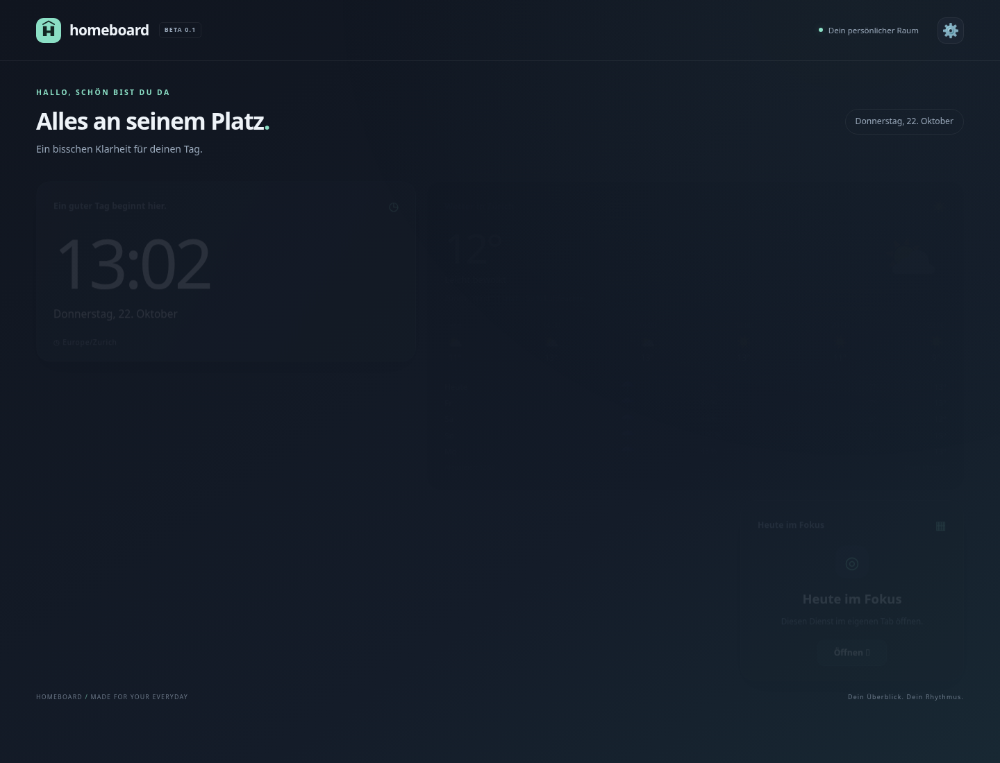
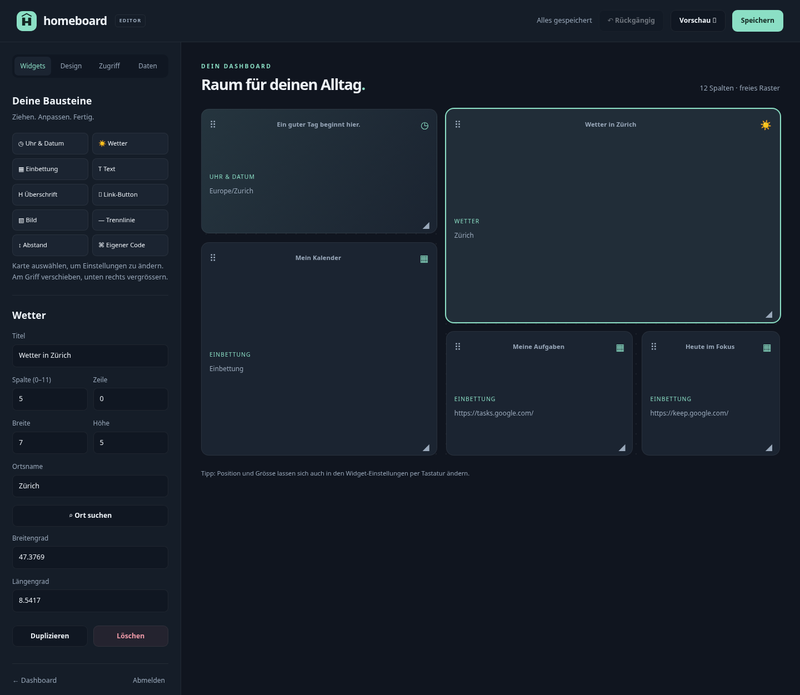

# Homeboard v0.1 · Beta

Ein persönliches Web-Dashboard für Windows 11 x64. **Eine EXE, ein lokaler Dienst, kein Browser-Autostart.** Selbst `http://localhost/` oder `http://<PC-IP>/` öffnen. Standardmässig ist nur localhost zugelassen.




## Technik und Umfang

Rust, Axum und Tokio passen zu einem kleinen, eigenständigen Backend. HTML, CSS, JavaScript und das Logo werden mit `rust-embed` direkt in die Release-EXE eingebettet. Unter Windows wird die C-Laufzeit statisch gebunden. Keine zusätzliche Laufzeitumgebung, kein Node, kein Docker, keine CDN-Abhängigkeit und kein Frontend-Build nötig. Der Editor verwendet ein eigenes kleines Pointer-Raster ohne externe Bibliothek.

- Dunkles Dashboard, helle Darstellung optional, responsive Karten, reduzierte Animationen bei entsprechender Systemeinstellung.
- Standard: Uhr/Datum auf Deutsch in `Europe/Zurich`, Wetter für Zürich, Kalender-Karte und zwei To-do-Link-Karten. Kalender und persönliche URLs im Editor einrichten.
- Wetter: aktuelle Werte, nächste Stunden und fünf Tage über Open-Meteo. Ortssuche ohne API-Key, alternativ Koordinaten. Serverseitiger Cache für 15 Minuten; bei Fehlern bleiben vorhandene Daten als veraltet markiert verfügbar. Nur das betroffene Widget zeigt einen Fehler. [Open-Meteo](https://open-meteo.com/) / [Wetterdaten-Lizenz](https://open-meteo.com/en/licence).
- Editor mit Anmeldung: verschieben, Grösse ändern, hinzufügen, duplizieren, löschen, Einstellungen, Vorschau, Speichern, 40 Schritte Rückgängig, zehn automatische Dateisicherungen, JSON-Import/Export.
- Bausteine: Uhr, Wetter, Text, Überschrift, Link, Bild-URL, iframe, Trennlinie, Abstand und eigener HTML/CSS/JS-Code.
- Globale Einstellungen: Hintergrundfarbe, CSS-Verlauf oder Bild-URL, Akzentfarbe, Schriftgrösse, Modus und eigenes CSS.

## Installation und erster Start

1. Unter [Releases](https://github.com/747elias/Homeboard/releases) `Homeboard-Setup-0.1.0-beta.exe` herunterladen und optional gegen `SHA256SUMS.txt` prüfen.
2. Setup ausführen. **Einmalige Adminrechte sind erforderlich**, weil nach `C:\Program Files\Homeboard\` installiert, ein Windows-Dienst registriert und optional die Firewall geändert wird.
3. Port 80 verwenden oder z. B. 8080 wählen. Das Setup stoppt bei belegtem Port mit einer verständlichen Meldung. Bei 8080 lautet die Adresse `http://localhost:8080/`.
4. Die Checkbox für eine Firewall-Freigabe ist **standardmässig aus**. Falls gewünscht, öffnet sie nur das private Netzwerkprofil für die Homeboard-EXE und den gewählten TCP-Port.
5. Selbst `http://localhost/edit` öffnen und ein Admin-Passwort mit 12–256 Zeichen setzen. Die erste Vergabe ist ausschliesslich direkt am PC über localhost möglich. Es gibt kein Standardpasswort.
6. Widgets konfigurieren und speichern. Für LAN-Geräte zuerst eine Whitelist-Regel hinzufügen und gegebenenfalls die private Firewall freigeben.

**Die EXE und der Installer sind nicht signiert. Windows SmartScreen kann deshalb warnen.** Vor dem Ausführen Herkunft und Prüfsumme kontrollieren.

Der Dienst `Homeboard` läuft automatisch beim Systemstart als **LocalService**, auch ohne angemeldeten Benutzer. Es gibt weder einen Autostart-Eintrag für den Browser noch einen automatisch geöffneten Tab. Startmenü-Verknüpfungen öffnen Dashboard und Editor nur auf Wunsch.

Die einzelne `homeboard.exe` kann ohne Installation im Konsolenmodus laufen. Nach regulärer Installation nicht zusätzlich starten, da der Port bereits belegt ist. Zum Ausprobieren ohne Adminrechte einen eigenen beschreibbaren Ordner und einen freien hohen Port nutzen:

```powershell
New-Item -ItemType Directory .\homeboard-data -Force
'{"bind":"127.0.0.1","port":8080}' | Set-Content .\homeboard-data\server.json -Encoding Ascii
.\homeboard.exe --data-dir .\homeboard-data
```

## Editor bedienen

- **Widgets:** einen Baustein anklicken, eine Karte auswählen und links ihre Einstellungen bearbeiten. Änderungen werden beim Verlassen des jeweiligen Eingabefelds in den Entwurf übernommen.
- **Raster:** am Griff `⠿` ziehen, unten rechts die Grösse ändern. Überlappende Karten rücken nach unten. Positionen und Grössen können auch per Eingabefeld geändert werden. Auf kleinen Displays ist die nummerische Bearbeitung vorgesehen; das Dashboard zeigt Karten untereinander.
- **Design:** Hintergrund und Farben wählen. Ein Verlauf ist z. B. `linear-gradient(145deg, #10151f, #182833)`. Eigenes CSS gilt im Dashboard und in der Vorschau, damit der Editor bedienbar bleibt.
- **Vorschau:** öffnet einen eigenen Tab mit dem aktuellen Entwurf. Pop-ups für localhost erlauben. Einbettungsprüfungen und Wetter neuer Widgets werden nach dem Speichern aktiv; die Vorschau erklärt das am betreffenden Widget.
- **Speichern:** aktiviert Änderungen sofort. Geöffnete Dashboards übernehmen sie innerhalb von 60 Sekunden. Jeder Speichervorgang sichert den vorigen Stand. Bei gleichzeitig geöffneten Editoren verhindert eine Revisionsprüfung versehentliches Überschreiben.
- **Rückgängig:** verwirft die letzten Entwurfsänderungen. Auch nach dem Speichern möglich; erneut speichern, um den rückgängig gemachten Stand zu aktivieren. Nach Neuladen stehen die Dateisicherungen zur Verfügung.
- **Daten:** JSON herunterladen oder importieren, anschliessend prüfen und speichern. Import ist zunächst nur ein Entwurf. Export enthält Widgets, URLs, Darstellung und Whitelist, niemals Passwort-Hash oder Sitzungen. URLs und eigener Code können persönliche Inhalte enthalten; Exporte entsprechend behandeln.
- **Eigener Code:** HTML, CSS und JavaScript im Widget eingeben. Ausführung in einem iframe mit `sandbox="allow-scripts"` und eigener CSP, ohne `allow-same-origin`, Formulare, Pop-ups, Netzwerkzugriff über Fetch oder Navigation des übergeordneten Fensters. Externe Bilder sind möglich. Ein absichtlich rechenintensives Skript kann trotzdem Browserressourcen verbrauchen.

## Google-Kalender und Google Tasks

Google Kalender im Browser öffnen → **Einstellungen** → unter „Einstellungen für meine Kalender“ den Kalender wählen → **Kalender integrieren** → **Code zum Einbetten**. Aus dem iframe-Code nur die URL aus `src="…"` übernehmen, typischerweise `https://calendar.google.com/calendar/embed?src=…&ctz=Europe%2FZurich`. HTML-Entities wie `&amp;` in `&` umwandeln. Diese URL im Kalender-Widget eintragen.

Der Kalender muss für den Browserbenutzer zugänglich sein. Einen privaten Kalender nicht allein für Homeboard öffentlich machen. Google-Anmeldung im eingebetteten Fenster kann durch Drittanbieter-Cookie-Regeln scheitern. In diesem Fall „Öffnen“ verwenden.

**Google Tasks bietet keinen offiziellen Web-Einbettungs-Link.** Die Tasks-Weboberfläche ist keine unterstützte iframe-Schnittstelle; Sicherheits- und Anmelderegeln können sie blockieren. Homeboard zeigt `tasks.google.com` deshalb immer als gestaltete Karte mit Symbol, Titel und „Öffnen“. Es wird keine funktionierende Tasks-Einbettung versprochen. Google Keep wird ebenfalls als Link geöffnet. Eine spätere Version kann eine **Google Tasks API**-Anbindung mit OAuth, sicherem Token-Speicher und eigener Listenansicht ergänzen; das ist nicht Teil von v0.1. Siehe [Tasks API](https://developers.google.com/workspace/tasks).

**Ehrliche Grenzen der automatischen Erkennung:** Browser geben einer übergeordneten Seite bei fremden iframes keinen zuverlässigen Erfolg-/Fehlerstatus. Ein `load`-Ereignis beweist daher keine funktionierende Einbettung. Homeboard prüft ausschliesslich die feste, vertrauenswürdige Google-Kalender-Embed-Adresse auf HTTP-Status, `X-Frame-Options` und CSP `frame-ancestors`, mit 15 Minuten Cache. Redirects werden nicht verfolgt. Beliebige URL-Ziele werden im Backend nicht abgerufen (Schutz vor internen Netzwerkabfragen). Unbekannte, blockierte oder nicht prüfbare Ziele werden im Automatikmodus konservativ als Ersatzkarte dargestellt.

Für einen bewusst gewählten anderen Anbieter kann „iframe bewusst aktivieren“ gewählt werden. Dann bleibt „Öffnen“ immer sichtbar, auch wenn die fremde Website selbst eine Blockierungsseite zeigt. Kein Workaround hebt die Sicherheitsregeln fremder Websites auf. Einbettungen und Bilder werden direkt vom Browser geladen; die Anbieter erhalten dabei normale Browseranfragen. Homeboard protokolliert deren Inhalte nicht.

## Zugriff und Whitelist

Editor → **Zugriff**. Ein Eintrag pro Zeile, Regeln werden mit ODER verknüpft:

```text
192.168.1.42
192.168.1.0/24
2001:db8::42
2001:db8:1234::/64
mac:02:aa:bb:cc:dd:ee
```

- `127.0.0.1` und `::1` bleiben immer erlaubt, auch ohne Einträge. IPv4-gemappte IPv6-Adressen werden normalisiert. IP und CIDR unterstützen IPv4 und IPv6.
- Whitelist gilt für Dashboard, Editor und APIs. Nur die Gestaltung der 403-Seite ist öffentlich zugänglich; sie enthält keine internen Details.
- **Editor nur von localhost** ist standardmässig eingeschaltet und schützt auch Login- und Editor-APIs. Abschalten ermöglicht angemeldete Administration von einer erlaubten IP.
- Eine erlaubte IP darf das Dashboard lesen, ohne Admin-Passwort. Breite Netze daher bewusst wählen. `X-Forwarded-For` und andere Proxy-Header werden ignoriert. Homeboard ist für direkten LAN-Zugriff vorgesehen, nicht hinter einem Reverse-Proxy.
- MAC-Regeln lesen unter Windows `Get-NetNeighbor`: IPv4 über ARP, IPv6 über die Nachbartabelle/NDP, maximal 30 Sekunden Cache. Es zählt nur ein exakter Nachbareintrag für die Verbindungs-IP. Keine MAC-Daten aus dem Browser.
- **MAC-Adressen sind nur im selben lokalen Netz sichtbar.** Hinter einem Router ist die entfernte Geräte-MAC nicht vorhanden. MAC-Spoofing ist möglich; MAC-Filter sind keine echte Sicherheitsgarantie. Auf Nicht-Windows-Systemen steht der MAC-Abgleich nicht zur Verfügung. Wenn die Nachbartabelle nicht auslesbar ist, bleibt der Zugriff verweigert, sofern keine IP-Regel passt.
- Nur direkte Adressen `localhost` und IP-Literale werden als Host akzeptiert (Schutz gegen DNS-Rebinding). Keine eigene DNS-Adresse in v0.1.
- Zugriff verweigert: animierte 403-Seite mit zwölf zufälligen Sprüchen. Log enthält Zeitpunkt und Verbindungs-IP, keine Header, URLs oder Inhalte.

Das Dashboard verwendet wie angefordert **HTTP ohne TLS**. Auf entfernten Geräten ist die Übertragung einschliesslich Passwort und Cookie nicht verschlüsselt. Deshalb in v0.1 den Editor vorzugsweise lokal belassen und nur in einem vertrauenswürdigen privaten Netz freigeben. Kein Portforwarding ins Internet einrichten.

## Passwort und Zugriff wiederherstellen

Passwörter werden als gesalzener Argon2id-Hash gespeichert. Sitzungen liegen nur im RAM, sind an die Verbindungs-IP gebunden, laufen nach acht Stunden ab und werden bei Dienstneustart oder Passwortwechsel ungültig. Cookie: `HttpOnly`, `SameSite=Strict`, `Path=/`; bei HTTP kann kein Secure-Cookie verwendet werden. Schreibaktionen erfordern passenden Origin und ein zufälliges CSRF-Token. Login erfordert JSON und passenden Origin. Nach fünf Fehlversuchen beginnt eine wachsende Sperre bis maximal fünf Minuten, zusätzlich maximal 60 Anmeldeversuche/Minute insgesamt. Zwei gleichzeitige Hash-Prüfungen begrenzen den Speicherbedarf.

Als Administrator in PowerShell; zuerst Dienst stoppen, damit er die Wiederherstellung nicht überschreibt:

```powershell
Stop-Service Homeboard
& 'C:\Program Files\Homeboard\homeboard.exe' --reset-access
# Nur bei vergessenem Passwort zusätzlich:
& 'C:\Program Files\Homeboard\homeboard.exe' --reset-password
Start-Service Homeboard
```

`--reset-access` leert die Whitelist und aktiviert „Editor nur localhost“. `--reset-password` löscht den Hash; anschliessend lokal unter `/edit` neu setzen. Passwortwechsel ist im Editor unter „Daten“ möglich und meldet alle Sitzungen ab. Niemals Passwörter per Kommandozeilenargument übergeben.

## Dateien, Port und Bind-Adresse

```text
C:\Program Files\Homeboard\
  homeboard.exe                   # inklusive aller Frontend-Dateien
  Uninstall.ps1, README.md, LICENSE, Verknüpfungsziele
%ProgramData%\Homeboard\
  server.json                     # Bind-Adresse und Port
  dashboard.json                  # Widgets, Design, Zugriff
  auth.json                       # ausschliesslich Argon2-Hash
  backups\dashboard-*.json         # letzte zehn Versionen
  logs\homeboard.*.log             # tägliche Rotation, maximal 14 Dateien
```

Das Setup beschränkt den Datenordner auf Administratoren, SYSTEM und LocalService. Normale Browserbenutzer brauchen keine Dateirechte und keine Adminrechte. Keine Passwörter, Widget-Inhalte oder Anfrage-URLs im Anwendungslog. Wetter wird nur im RAM gecacht. Im Leerlauf laufen keine Browserprozesse im Backend; die Oberfläche aktualisiert die Uhr einmal pro Sekunde, die Konfiguration einmal pro Minute und Wetter alle 15 Minuten.

`server.json`, nach Änderungen **Dienst neu starten**:

```json
{"bind":"::","port":80}
```

`::` bindet dual stack (IPv6 und IPv4); die Whitelist bleibt unabhängig davon auf localhost beschränkt. Nur lokal: `127.0.0.1`. Alternativ z. B. `{"bind":"0.0.0.0","port":8080}`. Wenn IPv6 im Betriebssystem vollständig deaktiviert ist, explizit IPv4 verwenden. Nach Portwechsel Firewall-Regel und Startmenü-URL-Dateien anpassen oder Setup mit dem neuen Port erneut ausführen. Das Setup übernimmt einen vorhandenen Bind-Wert und den im Dialog gewählten Port.

Port 80 kann durch IIS, HTTP.sys, andere Webserver oder reservierte Bereiche belegt sein. Diagnose: `Get-NetTCPConnection -LocalPort 80`, `netsh http show servicestate`; Homeboard nutzt einen TCP-Socket und benötigt keine HTTP.sys-URL-Reservierung. Alternativ Port 8080 verwenden. `homeboard.exe --check-port --port 80` prüft ohne Datenänderung und liefert einen Fehlercode bei Belegung.

Sicherung wiederherstellen: Dienst stoppen, gewünschte Datei aus `backups` als `dashboard.json` kopieren und Dienst starten. Beschädigte Konfigurationen werden beim Start nicht still überschrieben. `--data-dir PFAD` bzw. `HOMEBOARD_DATA_DIR` überschreibt das Datenverzeichnis für Entwicklung; im installierten Dienst werden die Standardpfade verwendet.

## Deinstallation

Windows → Installierte Apps → Homeboard → Deinstallieren. Dienst wird gestoppt und entfernt, Firewall-Regel `Homeboard-HTTP` und Verknüpfungen werden gelöscht. Eine Rückfrage bestimmt, ob `%ProgramData%\Homeboard\` erhalten bleibt. Unbeaufsichtigte Deinstallation behält Daten. Bei erneutem Setup bleiben Passwort und Dashboard-Konfiguration erhalten; Port und Firewall folgen den gewählten Setup-Optionen.

## Quellcode bauen und prüfen

Voraussetzungen für Windows-Build: Rust stable mit MSVC-Toolchain, Visual Studio Build Tools „Desktopentwicklung mit C++“, Windows SDK und [Inno Setup 6](https://jrsoftware.org/isinfo.php). `Cargo.lock` ist eingecheckt. Die Windows-C-Laufzeit wird über `.cargo/config.toml` statisch gebunden.

```powershell
cargo fmt --check
cargo clippy --locked --target x86_64-pc-windows-msvc --all-targets -- -D warnings
cargo test --locked --target x86_64-pc-windows-msvc
cargo build --locked --release --target x86_64-pc-windows-msvc
& "${env:ProgramFiles(x86)}\Inno Setup 6\ISCC.exe" installer\Homeboard.iss
```

Ergebnis: `target\x86_64-pc-windows-msvc\release\homeboard.exe` und `dist\Homeboard-Setup-0.1.0-beta.exe`. Für Entwicklung auf Linux: `cargo test`, `cargo run -- --data-dir work/dev-data`; davor `server.json` mit Port 8080 anlegen. Windows-Dienst und MAC-Nachbartabelle sind nur auf Windows verfügbar. Frontend-Dateien werden im Debug-Build von rust-embed vom Dateisystem gelesen; Release-Builds betten sie ein.

Unit- und HTTP-Tests decken IP/CIDR/MAC, Hashprüfung, Session-Ablauf, Fehlversuche, atomare Konfiguration/Sicherungen, Wetter-Parsing mit Beispieldaten, Origin-/Host-Prüfung, Login, CSRF, Speichern, Revisionskonflikte und Logout ab. Der Windows-Smoke-Test installiert das Setup unbeaufsichtigt auf einem frischen GitHub-Runner, prüft LocalService/Autostart-Konfiguration, HTTP, Anmeldung, Speichern, Dienstneustart, Wiederherstellung und Deinstallation. Er führt **keinen echten Windows-Neustart** aus und testet weder physische LAN-Geräte noch SmartScreen. Nicht auf einem Rechner mit produktiven Homeboard-Daten ausführen.

Der [manuelle Testplan](docs/TESTPLAN.md) enthält die verbleibenden Prüfungen auf echtem Windows 11. Der [Abschlussbericht](docs/ABSCHLUSSBERICHT.md) hält den tatsächlich beobachteten Stand fest.

## GitHub und Releases

Repository: https://github.com/747elias/Homeboard · Pre-release: https://github.com/747elias/Homeboard/releases/tag/v0.1.0-beta

- `build.yml`: Windows-Build, rustfmt, Clippy, Tests, Installer und Smoke-Test bei jedem Push/PR.
- `release.yml`: dasselbe bei einem `v*`-Tag, danach SHA256SUMS und automatisches GitHub-Pre-release mit beiden EXE-Dateien. Veröffentlichung erst nach erfolgreichen Prüfungen. Zum Wiederholen fehlgeschlagene Jobs erneut ausführen; der Upload ist wiederholbar.
- Actions verwendet nur `GITHUB_TOKEN` mit `contents: write` im Release-Workflow. Keine Tokens oder Passwörter im Repository.

Exakte lokale Befehle, falls kein GitHub-Zugriff vorhanden ist (GitHub CLI):

```powershell
gh auth login
git init -b main
git add .
git commit -m "Homeboard v0.1.0-beta"
# Nur falls das Repository noch nicht existiert:
gh repo create Homeboard --public --source . --remote origin
# Bei vorhandenem Repository stattdessen:
# git remote add origin https://github.com/747elias/Homeboard.git
git push -u origin main
git tag -a v0.1.0-beta -m "Homeboard v0.1.0-beta"
git push origin v0.1.0-beta
gh run list --repo 747elias/Homeboard --limit 10
gh run watch <RUN-ID> --repo 747elias/Homeboard --exit-status
gh run view <RUN-ID> --repo 747elias/Homeboard --log-failed
gh release view v0.1.0-beta --repo 747elias/Homeboard
gh release download v0.1.0-beta --repo 747elias/Homeboard
Get-FileHash .\homeboard.exe -Algorithm SHA256
Get-FileHash .\Homeboard-Setup-0.1.0-beta.exe -Algorithm SHA256
```

## Bekannte Grenzen der Beta

Keine Google-Tasks-API, kein OAuth-Token-Speicher, kein Kalender-Proxy. iframe-Erkennung ist browserbedingt begrenzt, MAC-Regeln gelten nur direkt im LAN. Kein TLS und keine öffentlichen Hostnamen; für privaten Betrieb vorgesehen. Maximal 100 Widgets, 256 Whitelist-Einträge, 1 MB Konfiguration pro Anfrage, 12 Spalten und maximal Zeile 500. Das mobile Layout ordnet Widgets untereinander an. Eigener Code ist funktional abgeschottet, besitzt aber keine garantierte CPU-/Speicherquote. Automatische Sicherungen sind lokal und ersetzen keine externe Datensicherung. Installationsabbrüche nach Dateiübernahme können eine Reparaturinstallation erfordern. Native Windows-Systemfunktionen und reale Hardware müssen gemäss Testplan abschliessend geprüft werden.

Lizenz: [MIT](LICENSE). Abhängigkeiten behalten ihre jeweiligen Lizenzen; [Cargo.lock](Cargo.lock) enthält die genaue Auflösung.
